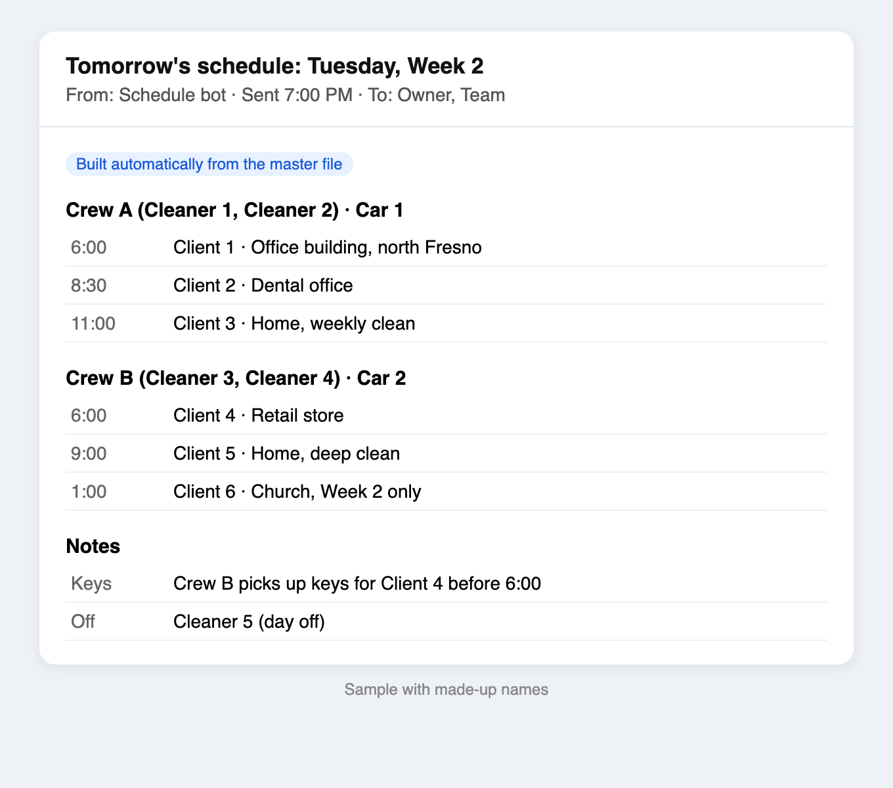
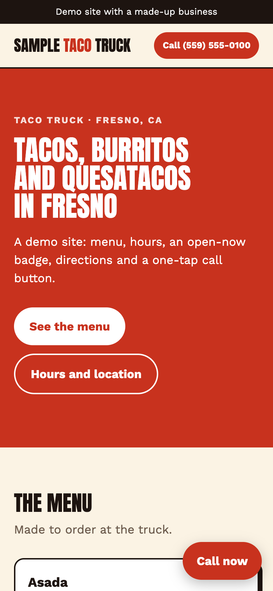

# John Linares

I've run a residential and commercial cleaning company in Fresno, California for 26 years. Over the past year I've used AI (Claude Code) to automate the office side of the business: schedules, client records, email, websites and phone answering. Now I build the same tools for other local small businesses.

**Website:** [lljanitorialservice.com](https://www.lljanitorialservice.com) · **X:** [@JuanL95](https://x.com/JuanL95)

---

## 1. Crew schedules that build themselves

All clients, crews, cars, keys, days off and our rotating two-week route plan live in one master file. Every evening at 7 PM a scheduled job reads the file, builds the next day's crew routes and emails them to me and my team. Nobody types a schedule by hand.

- **Updates by text message.** A Telegram bot takes changes in plain English or Spanish ("move Client 6 to Thursday", "Cleaner 3 is off Friday"), updates the master file and replies with what changed. Every change gets a dated entry in a change log.
- **It learns from real days.** When a real day's routes differ from the plan, I log them, and future schedules for that same weekday and week are built from the newest real example.
- **Client directory.** The same file builds a printable client directory as a PDF.
- **Built-in safety rules.** It never pairs two workers without a car, and nothing gets emailed from anywhere except the master file.

*Sample with made-up names. Real client names, addresses and building access details are never published.*

## 2. Websites for local businesses

I find local businesses that don't have a website, like taco trucks, painters and landscapers, and build them a one-page site using only facts they've already published: menu or services, hours, address and reviews. Every site has a one-tap call button, an "open now" badge, directions, and works on any phone.

*Demo with a made-up business.*

I also set up my own business website, verified our Google Business Profile so customers can find us on Search and Maps, and moved our email onto our own domain.

## 3. AI phone answering

An AI receptionist for after-hours and missed calls. It tells callers it's an AI, books free estimates, takes messages from current clients, flags urgent calls, and texts the owner a summary. It never makes commitments about prices and never gives out schedules or building access information. My own company is the first business it's being built for.

## 4. A trading system built on data

I connected AI to my Robinhood account and built a rules-based options trading system.

- **Tested before trusted.** Every rule is tested against months of real market data before it goes live, then checked again on data it hasn't seen.
- **Signal sources get audited.** I audited more than half a dozen paid and public alert services against their real trade history and dropped every one that showed no edge.
- **Runs on a schedule.** Checks run through the trading day. Every trade follows fixed entry, exit and risk rules, so emotion stays out of it.
- **The data decides.** No rule changes based on one good or bad week.

---

**Tools:** Claude Code, Python, scheduled jobs on macOS, Telegram bots, Gmail, Robinhood, GitHub, Cloudflare.

Most of my code stays private because it holds client and account information. This page shows what each system does.
